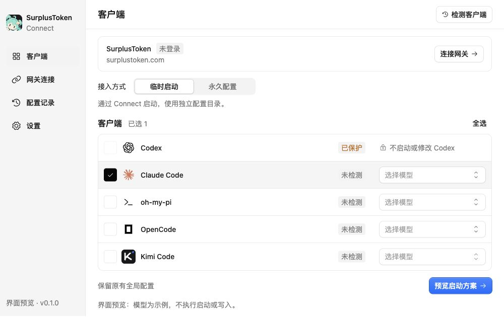

# SurplusToken Connect

使用 **Go + Wails v3** 构建的轻量桌面接入助手，将基于 Sub2API 的 SurplusToken 网关连接到用户已有的 AI 编程客户端。

目标体验：**登录网关 → 获取或创建 API Key → 选择客户端与模型 → 临时启动或永久配置。**

> 当前已完成可运行的中文界面预览，使用 Wails v3.0.0-beta.28。登录 API、客户端检测、真实模型发现、启动和配置写入尚未接入；界面不会执行这些操作。首批目标平台为 Windows 与 macOS。



旧版与 Kumo 版均保留供对比，见 [界面与打包体积对比](docs/ui-comparison.md)。

SuSu 品牌原图与生成说明见 [品牌资源](assets/branding/README.md)，本轮 [Kumo 规范审查](docs/kumo-audit.md)记录已修正问题。

## 产品目标

- 首版在 Connect 中输入网关账号密码，直接调用 HTTPS API 登录；暂不使用网页回调或本地监听。
- 检测可用 Key 与分组，优先复用合适的 Key；没有可用 Key 时，在用户授权的接入流程内创建专用 Key。
- 自动发现已安装客户端，获取模型目录，按客户端协议筛选模型，并允许用户覆盖推荐选择。
- 提供临时启动与永久配置两种模式，按客户端选择，不强制统一。
- 配置前展示脱敏变更预览，自动备份，支持恢复与冲突检测。
- 推理请求由客户端直接发送到网关，无常驻本地模型代理、无本地协议转换。

不纳入首版：完整网关管理后台、MCP/Skills 市场、会话管理、多供应商自动路由、客户端二进制修改。

## 两种接入模式

| | 临时启动 | 永久配置 |
| --- | --- | --- |
| 使用方式 | 从 Connect 或配套 CLI 启动客户端 | 配置后正常打开原有客户端 |
| 配置作用域 | 子进程环境、启动参数或必要的临时文件 | 客户端原生配置与凭据存储 |
| 原有配置 | 不改写用户级配置，检测覆盖冲突 | 仅修改选定字段，保留其他设置 |
| 生命周期 | 启动配置随进程结束失效，清理临时文件 | 重启后仍有效 |
| 卸载 Connect | 无法再通过 Connect 启动 | 已配置客户端应继续可用 |

临时启动仍可在 Connect 自己的凭据库中保存 Key；“临时”指客户端配置作用域，不等于完全不落盘。永久配置不能依赖卸载后消失的 Connect 凭据 helper。若客户端必须将 Key 写入普通文件，应在应用配置时清楚展示其存储位置。

## 目标客户端

以下均为待实现适配器。配置位置是调研入口，实际实现需识别版本、环境变量覆盖与自定义目录。

| 客户端 | 临时启动计划 | 永久配置计划 / 核实重点 |
| --- | --- | --- |
| Codex CLI | 进程环境与 CLI 配置覆盖 | 用户级 `~/.codex/config.toml` 与匹配的认证机制；原生 Responses 协议 |
| Codex Desktop / ChatGPT Desktop 中的 Codex | 单独验证应用启动、已有进程复用及环境继承；不预先保证 | 独立测试桌面版本、凭据读取、模型选择和实际请求路由 |
| Claude Code | 环境变量与主/辅助模型配置 | 原生 settings 与认证配置；检查既有设置是否覆盖注入 |
| oh-my-pi（`omp`） | 根据自身启动接口实现 | 当前上游使用 `~/.omp/agent/models.yml` 与 `config.yml`，不能套用 Pi 适配器 |
| OpenCode | 根据上游配置注入接口实现 | 合并用户配置，保留其他 provider、agent 与工具设置 |
| Kimi Code | 面向新 `MoonshotAI/kimi-code` 验证 | 当前文档为 `~/.kimi-code/config.toml`，支持 `KIMI_CODE_HOME`；区分已归档的旧版 |

Codex 接入仅针对编程功能，不意味着替换 ChatGPT 普通聊天后端。官方配置支持自定义 provider，但配置文件可写不等于所有桌面入口都验证通过。桌面凭据不能只依赖 shell 初始化文件中的 `export`。参见 [Codex 配置参考](https://learn.chatgpt.com/docs/config-file/config-reference)。

模型目录不是兼容性证明：需要区分 Responses、Chat Completions、Anthropic Messages，以及 streaming、工具调用、分组授权和客户端限制。模型名称不作为唯一判断依据；无法确认时显示“待验证”，不静默选择其他协议。

## 网关授权流程

1. 用户确认网关地址（默认 `https://surplustoken.com`），输入账号密码。
2. Connect 直接请求 `POST /api/v1/auth/login`，获取用户 access token；如需二次验证，按接口结果处理。
3. 使用用户 Bearer token 查询用户信息、Key 列表与可用分组，复用合适的 Key；没有可用 Key 时按用户选择创建专用 Key。
4. 使用推理 API Key 获取模型目录并检查权限，再选择客户端、模型与配置模式。
5. 展示脱敏变更，应用永久配置或构造临时启动方案。

首版不需要浏览器回调、loopback 服务或网关新增 Web Import 页面。账号密码仅用于登录，不保存到配置文件或日志；access token 默认仅在内存中使用。若后续支持保持登录，只将必要的 refresh token 存入操作系统凭据库，并处理过期、撤销与退出登录。

面板用户 token 与推理 API Key 分开管理，前者不能注入模型客户端，也不需要管理员 Key。若已有 Key 无法再次取回完整值，应创建专用 Key 或让用户手动导入。

2026-10-13 已用测试账号验证：登录、`GET /api/v1/user/profile`、`GET /api/v1/keys`、`GET /api/v1/groups/available` 均返回 200；当时 Key 列表为空，可用分组为 5 个。本次未创建 Key、未请求模型，也未把密码或返回的令牌写入仓库。Key 创建、刷新令牌及二次验证仍待联调。

## 配置目录与隔离

临时模式可以使用 Connect 专属目录，但目录覆盖不等于完整隔离：项目配置、系统策略、操作系统凭据库仍可能参与。优先仅为子进程设置对应变量，不修改系统级环境或用户 shell 配置。

| 客户端 | 目录/配置变量 | 作用与边界 |
| --- | --- | --- |
| Codex | `CODEX_HOME` | 默认 `~/.codex`，覆盖配置、文件认证与会话等状态根目录；指定目录需预先存在。系统凭据存储与 Desktop 行为另行验证 |
| Claude Code | `CLAUDE_CONFIG_DIR` | 将用户配置、会话和插件迁移到指定目录；不自动排除项目或受管配置 |
| Kimi Code | `KIMI_CODE_HOME` | 默认 `~/.kimi-code`；配置位于该目录的 `config.toml` |
| oh-my-pi | `PI_CODING_AGENT_DIR` | 默认 `~/.omp/agent`；原生 agent 数据目录覆盖，但通用配置发现不是全部跟随此变量；命名 profile 会忽略它 |
| OpenCode | `OPENCODE_CONFIG_DIR`、`OPENCODE_CONFIG`、`OPENCODE_CONFIG_CONTENT` | 分别指定配置目录、文件及内联 JSON；配置采用多层合并，凭据 `auth.json` 位于独立数据目录，不能只靠配置目录变量隔离 |

来源与详细边界见 [调研文档](docs/prior-work.md#客户端目录变量与隔离边界)。适配器应分别记录配置目录、凭据位置、会话目录和项目配置来源；用户未选择隔离目录时，应尊重已有环境变量，不硬编码默认路径。永久模式写入用户实际使用的配置位置，避免写进只有 Connect 启动时才读取的目录。

**当前开发约束：不启动、重启或测试运行 Codex CLI / Codex Desktop，也不改写当前使用中的 Codex 配置与凭据。** Codex 适配阶段只做文档/源码核查和临时目录中的静态夹具验证，实际运行测试待用户明确解除限制后再进行。

## 技术架构

采用 Go 负责核心逻辑，Wails v3 提供桌面窗口与 Go/前端桥接；前端采用 React + TypeScript + Vite，组件使用 Kumo 2.14.0。CLI 与 GUI 共享 Go 应用服务。

```text
Wails v3 GUI / CLI
        │
        ▼
Go application services
  ├── Gateway：授权、Key、分组、模型目录
  ├── Credentials：操作系统凭据库
  ├── Discovery：可执行文件、版本、配置目录
  ├── Adapters：各客户端协议、配置和启动方式
  ├── Config：预览、备份、合并、应用、恢复
  └── Launcher：进程环境、终端启动、退出清理

AI 编程客户端 ── 直接请求 ── SurplusToken / Sub2API
```

代码组织方向（当前仅有桌面入口与 frontend，其余按功能逐步建立）：

```text
cmd/connect/          CLI 入口
frontend/             Wails 前端
internal/app/         GUI / CLI 共享用例
internal/gateway/     Sub2API 登录、令牌与 Key API 集成
internal/credentials/ 凭据存取与脱敏
internal/clients/     每个客户端一个适配器
internal/config/      配置变更与恢复
internal/launcher/    跨平台进程和终端启动
docs/                 调研与设计
```

适配器分别提供探测、配置规划、应用、恢复、临时启动能力。只生成启动方案的逻辑不依赖 Wails、终端交互或磁盘写入，以便单独验证。

### 配置与凭据原则

- Connect 自身的秘密优先存入 macOS Keychain / Windows Credential Manager，日志与前端状态默认脱敏。
- 保留未知字段、用户自定义 provider、MCP 和其他无关设置；不能安全合并时停止写入并解释冲突。
- 原文件备份后进行最小修改；写入前校验快照未变化，再执行单文件原子替换。多文件操作记录逐项结果，失败时可恢复，不声称跨文件天然原子。
- 恢复时检查文件是否又被用户或客户端修改，避免旧备份覆盖新设置。备份与原始凭据采用相同等级的访问限制。
- API Key 不放入命令行参数、日志或 Git；子进程只获得运行所需的凭据。
- GUI 启动交互式 CLI 需要终端承载与正确的退出/信号处理，首版优先使用外部终端，内嵌终端另行评估。

## 开发路线

1. **基础闭环**：Wails v3 外壳、共享 Go 服务、手动 Key 导入、客户端发现、模型列表；先验证 Codex CLI 与 Claude Code 临时启动。
2. **永久配置**：变更预览、受限备份、最小合并、恢复与冲突检测；准备 Codex Desktop 静态配置验证，运行验证遵守下述限制。
3. **API 登录**：完成账号登录、分组选择、Key 复用/创建，以及令牌失效处理；不使用网页回调。
4. **适配扩展**：OpenCode、oh-my-pi、Kimi Code；每个客户端分别验证两种模式。
5. **发布**：Windows/macOS 安装包、签名与公证流程、升级策略，以及明确的客户端版本兼容表。

适配器验收至少覆盖：不含秘密的配置夹具、未知字段保留、重复应用幂等、写入失败恢复、外部修改冲突、临时启动不改全局配置，以及目标操作系统上的实际客户端请求。静态配置检查不能替代桌面端联调。

## 开发准备与参考源码

本机已验证 Go 1.27.2、Node.js 24.12.0；框架固定为 **Wails v3.0.0-beta.28**（Beta），前端为 React + TypeScript + Vite。本工程 macOS 编译部署目标为 13.0（不代表已验证最低系统上的 WebKit / Kumo 兼容性），需要 Xcode 开发工具，Windows 构建需要相应的 C 工具链与 WebView2；本轮只验证 macOS 构建。

```sh
# 安装依赖
npm --prefix frontend ci
go mod download

# 前端热更新预览（不调用原生功能）
npm --prefix frontend run dev

# 编译桌面应用
npm --prefix frontend run build
make build # macOS：包含一致的系统部署目标参数

# macOS / Linux 启动 Connect 自身
./bin/surplustoken-connect

# macOS 本地 .app 包（未签名、公证）
make package-mac
```

macOS 也可使用 `make run` 一步构建并启动；Windows 完成前端构建后使用 `go build -tags production -trimpath -o bin/surplustoken-connect.exe .`（本轮未验证）。当前无需全局安装 Wails CLI，尚未配置 Go 热重载和发行安装器。界面源码在 `frontend/src/`，桌面入口为 `main.go`。`build/` 平台资源纳入版本控制，`bin/` 和前端产物忽略。

界面包含客户端选择、双模式切换、示例模型选择、方案预览、网关登录表单、配置记录空状态和设置。模型是明确标注的示例，安装状态为“未检测”；启动先显示独立登录页，只提供账号、密码与登录按钮；提交仅用于预览进入主界面的流程，不发送认证请求、不存储密码。左下角头像按钮打开账号弹层，显示昵称（API 提供时）、完整邮箱和退出登录；当前账号信息来自本次输入，不代表真实已认证身份。Codex 条目保持锁定。默认窗口为 880 × 640，最小 820 × 600，采用浅色侧栏、白色内容区与品牌原色图标。设计依据见 [界面规范](docs/ui-guidelines.md)。

tf-cli 已作为本地临时参考克隆到 `.references/tf-cli/`，整个 `.references/` 被 Git 忽略，不是子模块或项目依赖。首次克隆可用：

```sh
git clone --depth 1 https://github.com/TokenFlux/tf-cli.git .references/tf-cli
```

本次参考提交：`d32cefdda83201aa92655083637b3e27e20cbf1d`（2026-10-13 查阅）。详细项目对比、源码入口和组件清单见 [Prior work 与可复用组件](docs/prior-work.md)。

## 许可

本项目尚未确定许可证。当前界面采用 Kumo、Phosphor Icons 与 Lobe Icons，来源与许可见 [第三方声明](THIRD_PARTY_NOTICES.md)。tf-cli 为 Apache-2.0，CC Switch 为 MIT；后续采用代码时记录来源、版本和修改，并保留适用的许可与版权声明。其他候选项目的许可与复用边界见调研文档。

Wails 外壳审计、已修复项与发行前缺项见 [Wails 排查报告](docs/wails-audit.md)。
