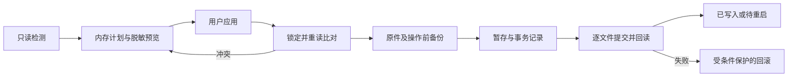

# 客户端配置、备份与恢复：源码调研和 Connect 流程

调研日期：2026-10-13；状态说明更新：2026-10-14。本文保留接入前的设计与源码研究，研究时的 UI 基线为 `db69eae`。当前已实现 Claude Code / OpenCode v2 的永久配置预览、备份、应用与恢复；临时启动、其他客户端适配及部分高级恢复能力仍待实现，详见 [当前实现](api-configuration-implementation.md)。本文所述参考源码调研只读取参考仓库和公开资料，没有运行参考应用、调用网关、读取用户认证文件或启动/修改 Codex。

## 结论

借鉴 tf-cli 的进程启动计划、CC Switch 的字段所有权和冲突处理、Magpie 的接管前状态记录。Connect 继续直连 SurplusToken，不引入本地推理代理。现有三个导航入口足够：客户端、配置记录、设置；用详情面板和弹窗承载修改、恢复、冲突与失败，不再新增一个完整备份管理主页。

临时启动与永久配置需要分开实现。临时注入不一定要换整个 HOME；独立数据目录也不等于临时文件，更不等于安全沙箱。退出 Connect 账号不应自动撤回客户端已经配置好的 Key。

## 固定源码版本

| 项目 | 本地参考提交 | 重点 |
| --- | --- | --- |
| [tf-cli](https://github.com/TokenFlux/tf-cli) | `d32cefdda83201aa92655083637b3e27e20cbf1d` | 进程参数、环境注入、模型协议匹配 |
| [CC Switch](https://github.com/farion1231/cc-switch) | `d9a62313c8a276216ed40245c638753606831e95` | 配置所有权、计划与提交、首写原件、编辑冲突 |
| [Magpie](https://github.com/yetone/magpie) | `a75fa9e54a7ec73a737681a3c345ae6fd0fe7d1f` | 客户端适配器、字段恢复、格式保留、加密导出 |
| [BigPizzaV3/CodexPlusPlus](https://github.com/BigPizzaV3/CodexPlusPlus) | `45f1c1516ea208434731917690932be05c4a0586` | Codex 配置快照、模型目录、多开与会话同步；详见另一篇文档 |

参考目录均在 `.references/`，被 Git 忽略。没有把这些工程变成运行依赖。

## 源码证据与复用方式

### tf-cli：把计划与启动分开

[`internal/harness/inject.go`](https://github.com/TokenFlux/tf-cli/blob/d32cefdda83201aa92655083637b3e27e20cbf1d/internal/harness/inject.go) 生成带程序、参数、环境与受管变量的 Plan。Codex 用 `-c` 设置 provider/model，Key 放专用子进程环境变量，没有写全局配置。Claude 会处理影响路由的已有变量；OpenCode 设置主模型和辅助模型，避免标题等后台任务落到不可用模型。

应借鉴纯计划接口和参数测试，不把清理环境变量或未知模型策略整段照搬。临时模式要让用户看到它会继承哪些已有配置、覆盖哪些连接字段。该仓库没有给 Connect 提供永久配置事务或 Desktop 多开实现。

### CC Switch：字段所有权、首写备份、冲突重试

[`live/mod.rs`](https://github.com/farion1231/cc-switch/blob/d9a62313c8a276216ed40245c638753606831e95/src-tauri/src/live/mod.rs) 将所有权、投影、格式补丁和写入引擎分层。[`live/engine.rs`](https://github.com/farion1231/cc-switch/blob/d9a62313c8a276216ed40245c638753606831e95/src-tauri/src/live/engine.rs) 在内存中计划，保存前后摘要，暂存同目录文件，并保留第一次接管前的原始字节；原文件不存在也记录，不凭空制造“旧文件”。

[`codex_direct.rs`](https://github.com/farion1231/cc-switch/blob/d9a62313c8a276216ed40245c638753606831e95/src-tauri/src/services/provider/codex_direct.rs) 将认证、配置、目录文件放进同一操作语义；联网准备在锁外进行，提交前重新读取。代码包含 pending 操作的崩溃恢复设计，不只是两次文件覆盖。

[`LiveEditConflictDialog.tsx`](https://github.com/farion1231/cc-switch/blob/d9a62313c8a276216ed40245c638753606831e95/src/components/providers/LiveEditConflictDialog.tsx) 展示冲突键，允许保留外部修改、使用自己的修改或取消。先 refuse 提交，遇到冲突后按选择重试。Connect 应使用同样的先检查后选择逻辑，覆盖重试仍必须对最新快照重新校验。

[`BackupListSection.tsx`](https://github.com/farion1231/cc-switch/blob/d9a62313c8a276216ed40245c638753606831e95/src/components/settings/BackupListSection.tsx) 的列表主要是应用数据库备份；恢复成功返回安全备份 ID。不要把其数据库备份直接当作用户的 `settings.json` / `config.toml` 恢复功能。

### Magpie：接管、断开与可移植备份分开

[`agent.go`](https://github.com/yetone/magpie/blob/a75fa9e54a7ec73a737681a3c345ae6fd0fe7d1f/internal/agent/agent.go) 的适配器包含检测路径、字段 Get/Set、选项、Notice 和 Sync。客户端有需要重启的、需要写模型目录的，也有只能通过导入链接配置的，不能统一假设为一个文件。

[`stash.go`](https://github.com/yetone/magpie/blob/a75fa9e54a7ec73a737681a3c345ae6fd0fe7d1f/internal/agent/stash.go) 保存接管前值，使用互斥和原子写入；损坏 stash 先留副本。它可能含 Key，文件按私密数据处理。恢复字段比覆盖整个配置文件更适合“断开 Connect”。空值与字段不存在仍需我们明确区分。

[`edit/file.go`](https://github.com/yetone/magpie/blob/a75fa9e54a7ec73a737681a3c345ae6fd0fe7d1f/internal/edit/file.go) 处理配置符号链接、文件属性与原子写入；目录字符串不是完整的写入目标，必须检测链接与实际路径。

[`backup/backup.go`](https://github.com/yetone/magpie/blob/a75fa9e54a7ec73a737681a3c345ae6fd0fe7d1f/internal/backup/backup.go) 的可移植包支持选择是否包含 Key，使用口令派生密钥和 AES-GCM 封装；恢复能选择内容部分。与本地字段 stash 是两种功能。云同步、订阅账号共享和本地协议转换属于其更大产品范围，首版不移植。

## Connect 需要的界面

| 入口 | 正常展示 | 异常/补充交互 |
| --- | --- | --- |
| 登录后的连接准备 | 读取用户分组、可用 Key 与模型；唯一明确选择可自动采用 | 多分组/多 Key 时出现简短选择弹窗；没有 Key 时显示创建动作。不要后台反复新建 Key |
| 客户端主页 | 实际检测结果、客户端版本/配置路径、模型、临时/永久模式、主操作 | 同一 Codex 行区分 CLI / Desktop 子状态；高级详情按需展开；协议不匹配给具体原因 |
| 客户端详情 | 当前连接来源、目标配置路径、Home/XDG 影响、已有设置 | 自定义目录、符号链接、项目设置、受管策略、其他切换工具造成的覆盖 |
| 应用预览弹窗 | 每客户端的字段级前后变化，秘密掩码；自动备份位置；需要重启的客户端 | 不改字段不展示成变更；无变化时直接说明。展开可见脱敏文本 diff；不能用脱敏 diff 作为真实写入数据 |
| 执行结果 | 各客户端独立状态：已启动 / 已写入 / 待重启 / 失败 | 部分失败不显示“全部成功”；失败步骤、是否已回滚、重试或打开记录 |
| 配置记录 | 时间、客户端、操作类型、结果、备份/事务 ID | 点开查看修改字段、目标文件、脱敏 diff；恢复自己的修改或还原完整快照 |
| 恢复预览弹窗 | 当前 → 目标，保留其他修改，先备份当前状态 | 同字段冲突、不再属于 Connect 的字段、丢失备份、损坏配置、已撤销操作 |
| 冲突弹窗 | 路径、冲突字段、外部改动摘要 | 保留当前、重新生成计划、明确选择覆盖；不默认整文件覆盖 |
| 设置 | 备份位置、保留策略、诊断与未来导出入口 | 首写原件/未完成事务不自动清理；含凭据的导出须明确范围并加密 |

不添加永久展开的全量 TOML/JSON 编辑器。主要界面继续用简洁语义：应用配置、已备份、恢复修改、需要重启。技术路径和差异放详情。

## 临时启动流程

1. 只读检测路径、可执行文件来源、协议和目标版本；保留 Codex 当前禁止执行的保护状态。
2. 生成 LaunchPlan：程序、非秘密参数、子进程环境增删、工作目录、辅助模型、临时文件清单。
3. 默认尽量使用原生进程覆盖以保留现有会话/扩展；“独立配置与历史目录”作为单独高级选项，目录持久保留会话，不随进程退出删除。
4. 必须写临时含秘密文件时创建私密目录，记录清理责任；不能靠“退出窗口”保证子进程已经退出。
5. 用户点击启动后，GUI 使用目标终端承载交互式 CLI，不能向无人读取的管道启动 TUI。PID、进程结束、退出码、清理失败分别记录。
6. 子进程退出后清理本次秘密文件；下次启动扫描遗留任务记录，确认不被活动进程占用后再回收。
7. 不修改用户 shell rc，不把 Key 塞进命令行或日志。进程环境不是安全沙箱，需要控制传入变量范围。

Desktop 临时启动不能直接套 CLI 的 -c 参数，详见 Codex 适配文档。

## 永久配置流程与状态

Go 核心负责 Plan / Apply / Restore / Recover，React 展示状态。应用接口使用服务端生成的 plan ID，不允许前端提供任意写入路径。计划包含 targetIdentity、beforeHash、afterHash、文件存在性、受管字段、敏感分类与客户端版本；设置变化或目标文件变化使计划失效。

多个客户端分成独立事务，允许部分成功。一个客户端的多文件操作按可恢复事务提交：同目录暂存、刷盘、记录 pending 和提交进度、替换并回读；多个 rename 不天然构成跨文件原子事务。备份或暂存失败时不开始修改 live 文件。

回滚只撤回这次实际写入且仍符合写入后摘要的文件；如果外部程序随后改过，保留现场，记录“回滚受阻”，不要进一步覆盖。进程间锁只能约束 Connect 自身，必须同时使用摘要检查。

配置解析失败时停止修改并给出位置，不能按默认空配置覆盖。JSONC/TOML/YAML 的字段保留、注释/顺序/BOM/CRLF 要有专项夹具；解析器支持读取不等于支持无损编辑。

## 三类备份与两种恢复

| 类型 | 内容 | 用途 |
| --- | --- | --- |
| 首次接管原件 | 原始字节、是否存在、模式/权限、链接路径与实际目标 | 找回 Connect 首次介入前的状态；不能被后续备份覆盖 |
| 每次操作前快照 | 此次目标文件、before/after 摘要、受管字段与事务阶段 | 撤销单次应用、故障恢复、显示历史 |
| Connect 可移植导出 | 非本机路径的连接设置、模型选择；凭据默认排除 | 换机或用户手动备份；后续再实现，不等同于完整用户目录备份 |

默认“恢复本次修改”：按字段三方比对 original / applied / current；当前仍等于 Connect 写入值才恢复原值，否则冲突；用户新增字段继续保留。创建新文件后若用户新增了内容，不能删掉整个文件。新增 provider 表也只能删除 Connect 拥有且未变的键。

高级“还原完整快照”：明确显示会覆盖哪些外部改动；先保存当前快照。只能选择已登记的目标，不能让导入包指定任意绝对路径。认证文件/钥匙串的恢复不是普通 TOML diff，需独立实现。

备份可能含密钥：本机目录/文件使用相应私密权限和 Windows ACL；日志与 UI 一律掩码。保留策略必须钉住首写原件、最后可恢复基线和 pending 事务。卸载默认保留已配置客户端和恢复资料；退出 SurplusToken 不自动撤销或销毁 Key。

## 其他应用的对照

- [relay-ai Codex 文档](https://github.com/jacob-bd/relay-ai/blob/main/docs/CODEX.md)：CLI 用侧挂 profile；Desktop 会修改全局配置并在退出流程中恢复，还依赖本地代理。它说明“临时使用 Desktop”可能实际上接管了全局文件，不能宣传为天然隔离。仅文档对照，未克隆/逐函数审计。
- [code-switch](https://github.com/daodao97/code-switch)：Go + Wails 的桌面代理管理工具，可参考壳与服务组织；目前只核查公开 README/已有调研，不把其备份机制当作已证实实现。

## 实现顺序与验收

1. Go 登录/用户/分组/Key/模型闭环，固定 SurplusToken 地址；用户 token 与推理 Key 分开。
2. 配置检测与计划器 + 临时目录夹具，不接触真实 Codex 目录。
3. 单客户端永久配置事务、字段恢复、首写原件、故障注入与重启恢复。
4. 再接配置记录与恢复 UI；错误状态先跑通，再开放多客户端批量应用。
5. 外部终端启动与目标 OS 验证；Codex 执行限制须由用户解除，研究不视为解除。

关键验收：相同应用幂等；未知字段/注释不丢；同字段冲突；计划后目录或链接变化；磁盘满；第二文件提交失败；崩溃后 pending 恢复；部分回滚受阻；删除/新建文件的存在性恢复；恢复前备份；备份中秘密不出现在日志；退出账号不破坏已配置客户端。
