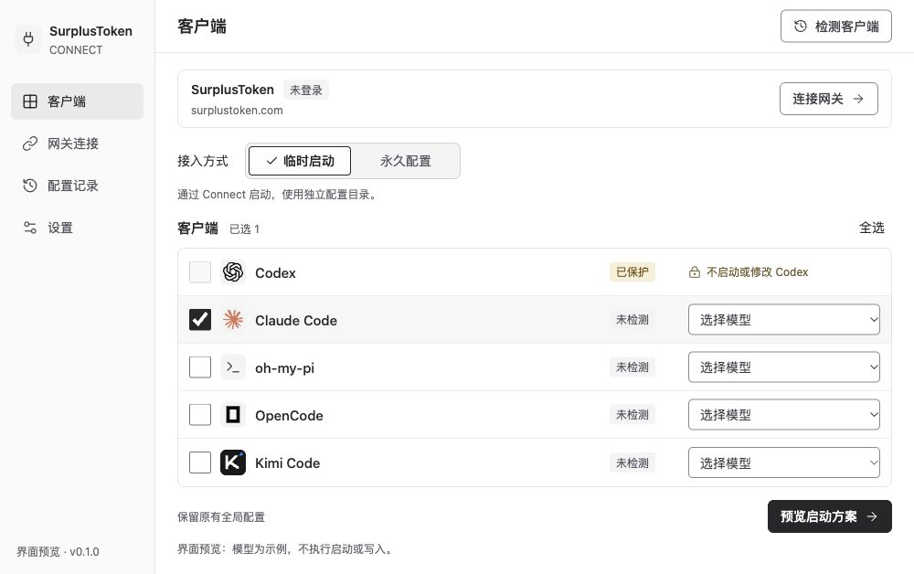
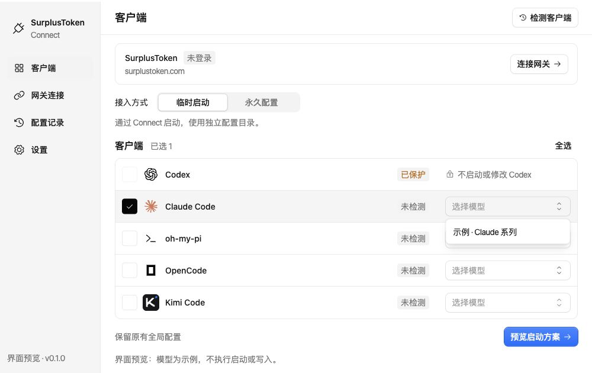

# 界面与打包体积对比

2026-10-13，本机 macOS arm64。旧版与 Kumo 版均为相同 Go/Wails 入口、production + trimpath 构建，未进行签名、公证或 UPX 压缩。单位使用十进制 MB/kB。

| 指标 | 旧版（原生控件） | React + Kumo 2.14.0 | 增量 |
| --- | ---: | ---: | ---: |
| .app 文件总量 | 13.43 MB | 14.09 MB | +0.66 MB |
| ZIP（Deflate level 9） | 7.31 MB | 7.50 MB | +0.19 MB |
| 前端全部资源 | 33.08 kB | 687.34 kB | +654.26 kB |
| JS | 12.79 kB | 528.52 kB | +515.73 kB |
| CSS | 8.68 kB | 143.95 kB | +135.27 kB |
| JS + CSS 独立 gzip 合计 | 7.84 kB | 188.91 kB | +181.06 kB |

应用大小增加 4.9%；ZIP 增加 2.6%。前端占比上升明显，但两版主体均为 Go/Wails 可执行文件。gzip 是资源压缩参考，并非额外扣减后的应用大小。

## 打开对比

- 旧版预览：http://127.0.0.1:5174/ （已启动本地静态服务器）
- Kumo 预览：http://127.0.0.1:5173/ （当次预览地址，不保证当前运行）
- 旧版应用：`.references/comparison/baseline/SurplusToken Connect.app`
- Kumo 应用：`.references/comparison/kumo/SurplusToken Connect.app`
- 各目录同时保留 frontend-dist 与 ZIP；旧版为可运行产物快照，不是独立源码分支。
- 两份应用具有相同 bundle ID，比较原生窗口时请先退出上一份，再打开另一份；浏览器预览可同时打开。

## 差异与验证

Kumo 版完整迁移到 React，选择器、分段 Tabs、复选框、按钮、输入框和对话框采用组件库。模式切换不再增删勾号，固定文字和按钮尺寸。检查模型选择、键盘打开菜单、Escape 及弹窗返回焦点；589px 视口无横向溢出。macOS 包完成构建，尚未测启动时间、常驻内存与 Windows 包大小。

本次比较的两版构建都只包含 UI 原型，不会执行客户端启动或配置写入。这是 2026-10-13 UI 阶段的体积快照；当前工程已接入 API 与配置写入，需重新构建测量，不能将表中数据当作当前包或最终产品体积。

